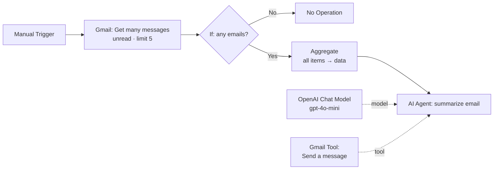

# 📬 Gmail Unread Digest — n8n + AI Agent

An n8n workflow that reads your latest unread Gmail messages and uses an AI agent (OpenAI `gpt-4o-mini`) to summarise each one in a single line. The agent flags anything that needs action and then emails the digest back to you.


---

## ✨ What it does

1. Fetches up to **5 unread emails** from your Gmail inbox.
2. Stops quietly when there are no unread emails.
3. Combines the emails into a single payload.
4. An **AI Agent** writes a short digest with one line per email (sender, subject, and any action, deadline or amount), followed by an **"Action needed"** section.
5. The agent calls a **Gmail tool** to send the digest to you, with a subject line like `Unread Email Digest – 21 Oct 2026` (dated in IST).

### Sample output

```
Hi Dinesh,

Here are your latest unread emails:

1. Ravi Kumar – Invoice #4521: Supplier invoice of ₹18,500 due by 25 Oct; payment confirmation requested.
2. GitHub – Security alert: New sign-in detected on your account from a new device.
3. HR Team – Diwali holiday notice: Office closed on 31 Oct and 1 Nov.

Action needed: Email 1 – confirm payment of ₹18,500 before 25 Oct.
```

---

## 🔀 Workflow



| Node | Type | Purpose |
|---|---|---|
| When clicking 'Execute workflow' | Manual Trigger | Starts the workflow on demand |
| Get many messages | Gmail | Fetches the 5 most recent unread messages (`alwaysOutputData` is on, so an empty inbox still continues) |
| If | If | Checks that the item has data, which separates real emails from an empty result |
| No Operation, do nothing | No-Op | End of the flow when there are no unread emails |
| Aggregate | Aggregate | Merges all emails into one `data` array for a single AI call |
| summarize email | AI Agent | Builds the prompt (From, Subject, Date in IST, snippet) and writes the digest |
| OpenAI Chat Model | LangChain LLM | `gpt-4o-mini` with up to 3 retries |
| Send a message in Gmail | Gmail Tool | Called by the agent to send the digest as plain text |

---

## ⚙️ Setup

### Prerequisites
- An n8n instance, either self-hosted or n8n Cloud
- A Google account with the Gmail API enabled
- An OpenAI API key

### Steps
1. In n8n, go to **Workflows → Import from File** and select `Gmail Unread Digest.json`.
2. Add credentials:
   - **Gmail OAuth2:** connect your Google account, and assign it to both *Get many messages* and *Send a message in Gmail*.
   - **OpenAI:** add your API key and assign it to *OpenAI Chat Model*.
3. Click **Execute workflow**. The digest should arrive in your inbox.

> 🔒 Credentials are stored in n8n, not in the JSON export. Even so, never commit real API keys to the repo.

---

## 🛠️ Customisation

| Want to… | Change |
|---|---|
| Run automatically every morning | Replace the Manual Trigger with a **Schedule Trigger** (e.g. 7:00 AM IST) |
| Summarise more emails | Increase `limit` in *Get many messages* (and update "up to 5" in the system prompt) |
| Send to a fixed address | Set *sendTo* to your email instead of `{{ $json.data[0].To }}` |
| Change the tone or format | Edit the agent's **System Message** |
| Use full email bodies | Turn off *Simplify* in the Gmail node and pass the body text instead of `snippet` (this uses more tokens) |

---

## ⚠️ Known limitations

- **Snippet only:** the AI sees Gmail's ~200-character preview, not the full email, so long emails may be summarised incompletely.
- **Recipient comes from the first email:** `sendTo` uses the `To` field of the first unread email. If that email was sent to a group, alias or list, the digest goes there. A fixed address is safer.
- **Emails stay unread:** the workflow doesn't mark messages as read, so they reappear in the next digest. You can add a Gmail "Mark as read" step if you want.
- **Sending depends on the agent:** the email is sent only when the model calls the tool. For guaranteed delivery, use a plain Gmail node after the agent instead of the tool.

---

## 📚 Learnings

Built as part of my GenAI and automation learning. It covers:
- n8n AI Agent nodes with **tool calling** (`$fromAI` parameters)
- Aggregating items so the model gets one batched prompt per run
- Prompt design for strict, hallucination-free summaries

---

**Author:** [Dineshkumar Palanisamy](https://www.linkedin.com/in/pdineshkumar55) · [GitHub](https://github.com/pdineshkumar55)
